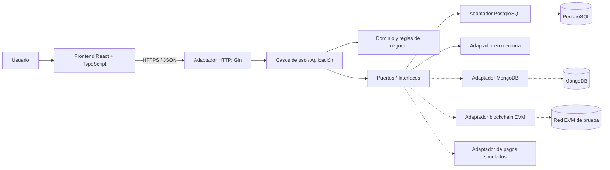

## Krea Nova

> Prototipo académico de una plataforma de **financiamiento colectivo inmobiliario** con participaciones representadas digitalmente (tokenización RWA), pensada bajo el marco normativo de la República Argentina.


---

> [!WARNING]
> **Este proyecto tiene fines exclusivamente académicos.** No recibe ni custodia dinero real, no realiza ofertas públicas, no emite valores negociables y no custodia activos ni claves privadas de clientes. Los pagos, los controles KYC/AML y las operaciones de inversión son **simulados** o se ejecutan en entornos de prueba. No constituye asesoramiento de inversión ni promesa de rentabilidad.

## Tabla de contenidos

- [Descripción](#descripción)
- [Funcionalidades](#funcionalidades)
- [Arquitectura](#arquitectura)
- [Stack tecnológico](#stack-tecnológico)
- [Estructura del repositorio](#estructura-del-repositorio)

## Descripción

**Krea Nova** conecta a empresas constructoras o desarrolladoras que necesitan financiar una obra con personas interesadas en invertir en proyectos inmobiliarios.

Una desarrolladora presenta un proyecto (descripción, presupuesto, cronograma, documentación y objetivo financiero). Antes de publicarlo, el proyecto pasa por una **revisión legal, técnica y financiera simulada**. Una vez aprobado, los inversores pueden consultar la información y simular su participación.

La participación económica se representa mediante un **token en una red blockchain de prueba**. El token no equivale por sí mismo a una parte física del edificio: debe asociarse a un derecho económico definido por un instrumento jurídico subyacente, cuya estructura queda sujeta a análisis legal (ver [`legal.md`](./legal.md)).

## Funcionalidades

- **Registro y autenticación** con onboarding regulatorio diferenciado:
  - *Persona Humana* (inversor individual): DNI, CUIL (validación módulo 11), mayoría de edad, domicilio, origen de fondos, declaración PEP y consentimiento Ley 25.326.
  - *Persona Jurídica* (desarrolladora/constructora): razón social, tipo societario, CUIT, inscripción IGJ/DPPJ y representante legal con poder.
- **KYC y validación de elegibilidad simulados.**
- **Gestión de proyectos** y flujo de revisión/aprobación antes de su publicación.
- **Catálogo de oportunidades** con cálculo de APY estimado en USD.
- **Inversión primaria** con pagos simulados y **ledger** contable de partida doble.
- **Portfolio** del inversor.
- **Mercado secundario** interno demostrativo (órdenes de compra/venta con matching off-chain).
- **Panel de revisión administrativa** de proyectos.
- **Interfaz dual-theme** (modo oscuro *Deep Obsidian* y modo claro *Nordic Porcelain*).

## Arquitectura

El backend sigue una **arquitectura hexagonal (Ports & Adapters)** con principios de **Domain-Driven Design**, organizada como un **monolito modular**. El dominio no depende de Gin, PostgreSQL, React ni de ningún proveedor blockchain concreto.



> Las líneas punteadas representan componentes **diseñados pero aún no implementados**.

**Regla de dependencias:** el dominio no importa ni conoce los adaptadores; los adaptadores implementan las interfaces (puertos) definidas hacia el interior. El punto de composición (`backend/cmd/api/main.go`) conecta cada puerto con su implementación concreta.

### Principios de diseño

1. Las reglas de negocio son independientes de frameworks e infraestructura.
2. PostgreSQL es la fuente de verdad de las operaciones transaccionales y del ledger.
3. La blockchain es un adaptador externo y no sustituye a la base operacional.
4. Los flujos financieros son idempotentes, auditables y verificables mediante pruebas.
5. Los datos personales permanecen fuera de la cadena.
6. Se prioriza un monolito modular mantenible antes que microservicios.

## Stack tecnológico

| Capa | Tecnologías |
|------|-------------|
| **Frontend** | React 19, TypeScript, Vite, React Router 7, Lucide Icons |
| **Backend** | Go, Gin, pgx (PostgreSQL), `bcrypt` y AES-256-GCM (`x/crypto`) |
| **Base de datos** | PostgreSQL 16+ (migraciones SQL versionadas) |
| **Planificado** | MongoDB (datos documentales), MinIO/S3 (archivos), red EVM de prueba (tokens), Docker Compose |

## Estructura del repositorio

```text
.
├── backend/
│   ├── cmd/api/main.go                  # Punto de composición (wiring de puertos y adaptadores)
│   ├── internal/
│   │   ├── domain/                      # Entidades y reglas: user, project, fund
│   │   ├── application/
│   │   │   ├── ports/                   # Interfaces de repositorios
│   │   │   └── services/                # Casos de uso
│   │   ├── adapters/
│   │   │   ├── inbound/http/gin/        # Handlers REST
│   │   │   └── outbound/
│   │   │       ├── postgres/            # Repositorios PostgreSQL
│   │   │       └── memory/              # Repositorios en memoria (desarrollo/tests)
│   │   ├── security/
│   │   │   ├── crypto/                  # AES-256-GCM + bcrypt
│   │   │   └── validation/              # Validadores de entrada
│   │   └── config/                      # Configuración por variables de entorno
│   └── migrations/                      # Esquema SQL versionado
├── frontend/
│   └── src/
│       ├── features/                    # auth, landing, projects, portfolio, secondary-market, admin, dashboard
│       ├── components/                  # Layout y componentes comunes
│       ├── context/                     # Tema (dual-theme)
│       ├── services/                    # Cliente de API
│       └── styles/                      # Design tokens y estilos
├── docs/                                # Documentación técnica y legal
├── legal.md                             # Requisitos legales y regulatorios
└── ProyectoFinal_Arquitectura_y_Descripcion.md   # Documento base del proyecto
```
