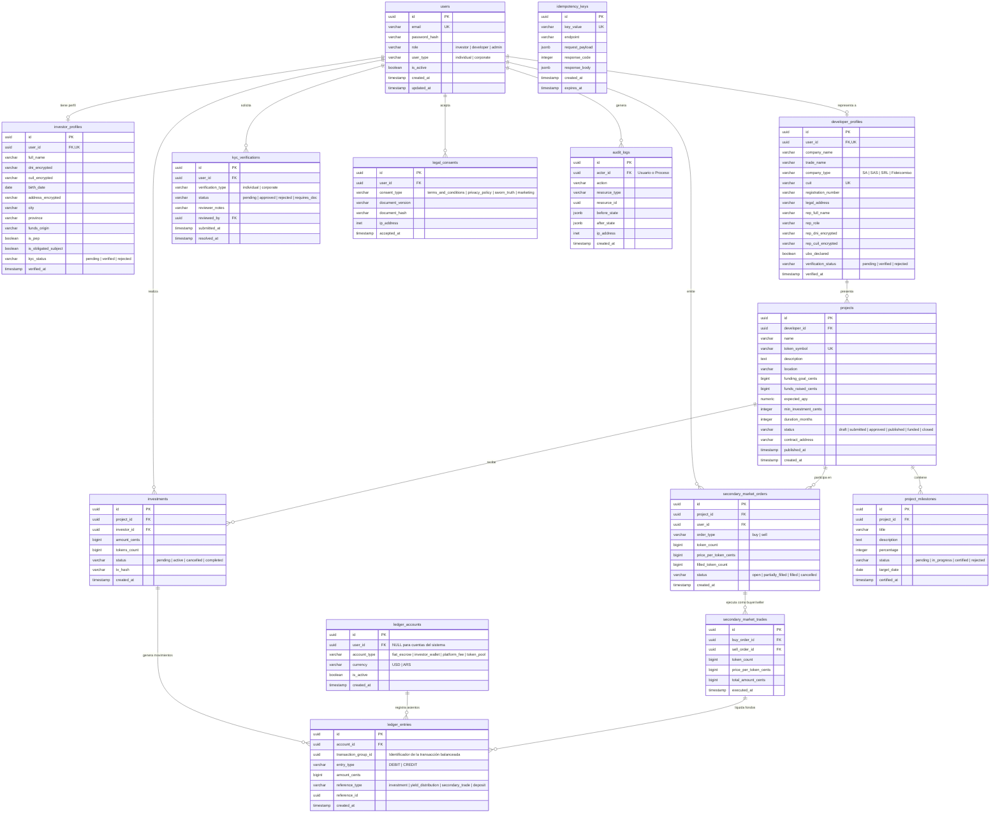

# Diseño de Base de Datos, Modelo Entidad-Relación y Reglas de Seguridad

**Proyecto:** Krea Nova — Real Estate Investments  
**Tipo:** Plataforma Fintech de Financiamiento Colectivo Inmobiliario  
**Arquitectura:** Persistencia Políglota (PostgreSQL Transaccional + MongoDB Documental + MinIO Object Storage)  
**Marco Normativo:** Ley 25.326 (Protección de Datos), Res. UIF 49/2024 (Prevención LA/FT), Ley 26.831 (Mercado de Capitales)  
**Versión:** 1.0  
**Fecha:** 27 de Octubre de 2026  

---

## 1. Arquitectura de Almacenamiento y Separación de Responsabilidades

Para garantizar la integridad transaccional (ACID), el cumplimiento estricto de la normativa de privacidad y la trazabilidad financiera, el sistema divide la persistencia en cuatro capas desacopladas:

```mermaid
flowchart TD
    subgraph AppLayer["Capa de Aplicación (Go Hexagonal Backend)"]
        AUTH["Auth & Users"]
        PROJ["Projects & Due Diligence"]
        FIN["Investments & Ledger"]
        MKT["Secondary Market"]
    end

    subgraph PG["PostgreSQL 16+ (Fuente de Verdad Transaccional)"]
        PG_CORE["Cuentas, Perfiles, Roles, Estados KYC"]
        PG_PROJ["Proyectos, Emisiones, Hitos de Obra"]
        PG_LEDGER["Libro Mayor (Double-Entry Ledger)"]
        PG_ORDERS["Órdenes de Compra/Venta y Liquidación"]
        PG_SEC["Idempotencia, Auditoría, Consentimientos Legales"]
    end

    subgraph MONGO["MongoDB 7+ (Documental Semiestructurado)"]
        MG_DD["Due Diligence: Cuestionarios, Respuestas y Checklists Legales"]
        MG_EVID["Metadatos y Bitácora Pericial de Avance de Obra"]
        MG_TECH["Dictámenes Técnicos y Estudios de Suelo"]
    end

    subgraph S3["Object Storage Cifrado (MinIO / S3)"]
        S3_DOCS["PDFs de Escrituras, Planos Municipales, Estatutos"]
        S3_KYC["Fotos de DNI y Constancias de CUIT (Cifrado AES-256)"]
    end

    subgraph CHAIN["Blockchain EVM (Testnet)"]
        EVM_LOG["Hashes de Emisión y Eventos Públicos de Transferencia"]
    end

    AUTH -->|Transaccional| PG_CORE
    AUTH -->|Metadatos / Archivos| S3_KYC
    PROJ -->|Datos Clave / Estados| PG_PROJ
    PROJ -->|Informes Variables| MG_DD
    PROJ -->|Planos / Binarios| S3_DOCS
    FIN -->|Partida Doble Inmutable| PG_LEDGER
    FIN -->|Hashes Notariales| EVM_LOG
    MKT -->|Matching Off-Chain| PG_ORDERS
```



---

## 2. Reglas de Seguridad y Cumplimiento Normativo

### 2.1. Gestión de Credenciales y Autenticación

1. **Hash de contraseñas:** Ninguna contraseña se almacena en texto plano. Se utiliza **Argon2id** (configuración recomendada OWASP: memoria 64MB, tiempo 3 iteraciones, paralelismo 2) o **Bcrypt** con factor de coste no menor a 12.
2. **Tokens de sesión:** Uso de tokens opacos revocables persistidos en PostgreSQL o JWT efímeros (vida máxima 15 minutos) con Refresh Tokens almacenados en base de datos bajo rotación criptográfica (`token_hash`, expiración y estado de revocación).

### 2.2. Protección de Datos Personales (Ley 25.326)

1. **Cifrado de campos sensibles (PII):** Los números de documento (DNI), CUIL/CUIT de personas humanas y domicilios reales deben almacenarse cifrados en reposo utilizando `pgcrypto` (`pgp_sym_encrypt`) con claves maestras administradas fuera del código fuente o mediante cifrado en capa de aplicación (AES-256-GCM).
2. **Prohibición absoluta en Blockchain:** Queda terminantemente prohibido almacenar DNI, CUIL, nombres, correos o datos bancarios en contratos inteligentes o transacciones blockchain.
3. **Consentimiento rastreable:** Cada consentimiento legal (Términos, Privacidad, Declaración PEP) se registra con `version_id`, `user_id`, `ip_address` y `timestamp` inmutable.

### 2.3. Integridad Financiera y Ledger de Partida Doble (Double-Entry)

1. **Inmutabilidad de saldos:** Los saldos de las cuentas no se modifican con `UPDATE balance = balance + X`. El saldo es el resultado de la suma de asientos en el libro mayor (`ledger_entries`).
2. **Regla de balance cero:** Todo movimiento financiero genera al menos dos asientos (`DEBIT` y `CREDIT`) cuya suma algebraica debe ser exactamente cero:
   $$
   \sum \text{Debits} - \sum \text{Credits} = 0
   $$
3. **Claves de Idempotencia:** Todo endpoint financiero requiere el encabezado `Idempotency-Key` (UUIDv4) registrado en la tabla `idempotency_keys` para evitar dobles cobros o suscripciones duplicadas por reintentos de red.

### 2.4. Regla de Bloqueo Regulatorio

- Si el campo `kyc_status` del usuario es diferente de `'verified'`, el backend rechaza a nivel de base de datos (`CHECK` constraint o trigger) la inserción de registros en la tabla `investments` y `secondary_market_orders`. No existe inversión diferida sin validación previa.

### 2.5. Principio de Menor Privilegio (DB Roles)

- **`app_dml_user`:** Rol utilizado por el servicio Go en tiempo de ejecución. Permisos exclusivos de `SELECT`, `INSERT`, `UPDATE` sobre tablas operativas. Prohibido ejecutar `DROP`, `ALTER` o `TRUNCATE`.
- **`app_migrator`:** Rol exclusivo para ejecutar migraciones versionadas de base de datos durante el despliegue.

---

## 3. Diagrama Entidad-Relación (Mermaid ERD)



---

## 4. Diccionario de Datos e Índices de Rendimiento (PostgreSQL)

### 4.1. Módulo de Identidad y Perfiles

#### Tabla `users`

Contiene las credenciales primarias y el tipo de actor.

- `id` (`UUID`, PK, `gen_random_uuid()`): Identificador global.
- `email` (`VARCHAR(255)`, UNIQUE, NOT NULL): Correo electrónico en minúsculas.
- `password_hash` (`VARCHAR(255)`, NOT NULL): Hash Argon2id o Bcrypt.
- `role` (`VARCHAR(20)`, NOT NULL): `'investor'`, `'developer'`, `'admin'`.
- `user_type` (`VARCHAR(20)`, NOT NULL): `'individual'`, `'corporate'`.
- `is_active` (`BOOLEAN`, DEFAULT TRUE, NOT NULL).
- `created_at`, `updated_at` (`TIMESTAMPTZ`, NOT NULL).
- **Índices:** `CREATE UNIQUE INDEX idx_users_email ON users(email);`

#### Tabla `investor_profiles`

Legajo individual bajo cumplimiento KYC y Ley 25.326.

- `id` (`UUID`, PK).
- `user_id` (`UUID`, FK `users(id)`, UNIQUE, NOT NULL).
- `full_name` (`VARCHAR(150)`, NOT NULL).
- `dni_encrypted` (`BYTEA` / `TEXT`, NOT NULL): Almacenamiento cifrado.
- `cuil_encrypted` (`BYTEA` / `TEXT`, NOT NULL): Almacenamiento cifrado.
- `birth_date` (`DATE`, NOT NULL): Con restricción de edad:  
`CHECK (birth_date <= CURRENT_DATE - INTERVAL '18 years')`.
- `address_encrypted` (`TEXT`, NOT NULL).
- `city` (`VARCHAR(100)`, NOT NULL).
- `province` (`VARCHAR(100)`, NOT NULL).
- `funds_origin` (`VARCHAR(100)`, NOT NULL): Ahorros, renta, honorarios, etc.
- `is_pep` (`BOOLEAN`, NOT NULL, DEFAULT FALSE).
- `is_obligated_subject` (`BOOLEAN`, NOT NULL, DEFAULT FALSE).
- `kyc_status` (`VARCHAR(20)`, DEFAULT `'pending'`, NOT NULL): `'pending'`, `'verified'`, `'rejected'`.
- `verified_at` (`TIMESTAMPTZ`, NULL).
- **Índices:** `CREATE INDEX idx_investor_kyc_status ON investor_profiles(kyc_status);`

#### Tabla `developer_profiles`

Personería jurídica de desarrolladoras y constructoras (Ley 19.550).

- `id` (`UUID`, PK).
- `user_id` (`UUID`, FK `users(id)`, UNIQUE, NOT NULL).
- `company_name` (`VARCHAR(200)`, NOT NULL): Razón social exacta.
- `trade_name` (`VARCHAR(150)`, NOT NULL): Nombre de fantasía comercial.
- `company_type` (`VARCHAR(50)`, NOT NULL): `'SA'`, `'SAS'`, `'SRL'`, `'Fideicomiso'`.
- `cuit` (`VARCHAR(13)`, UNIQUE, NOT NULL): Formato 30-XXXXXXXX-X validado por Módulo 11.
- `registration_number` (`VARCHAR(100)`, NOT NULL): Registro IGJ / DPPJ.
- `legal_address` (`VARCHAR(250)`, NOT NULL).
- `rep_full_name` (`VARCHAR(150)`, NOT NULL): Representante legal con poder.
- `rep_role` (`VARCHAR(100)`, NOT NULL): Cargo del representante.
- `rep_dni_encrypted` (`TEXT`, NOT NULL).
- `rep_cuil_encrypted` (`TEXT`, NOT NULL).
- `ubo_declared` (`BOOLEAN`, NOT NULL, DEFAULT FALSE): Declaración Beneficiarios Finales.
- `verification_status` (`VARCHAR(20)`, DEFAULT `'pending'`, NOT NULL).
- `verified_at` (`TIMESTAMPTZ`, NULL).
- **Índices:** `CREATE UNIQUE INDEX idx_dev_cuit ON developer_profiles(cuit);`

---

### 4.2. Módulo de Proyectos e Inversiones

#### Tabla `projects`

- `id` (`UUID`, PK).
- `developer_id` (`UUID`, FK `developer_profiles(id)`, NOT NULL).
- `name` (`VARCHAR(150)`, NOT NULL).
- `token_symbol` (`VARCHAR(10)`, UNIQUE, NOT NULL): Prefijo de participación digital (ej. `KN-01`).
- `description` (`TEXT`, NOT NULL).
- `location` (`VARCHAR(200)`, NOT NULL).
- `funding_goal_cents` (`BIGINT`, NOT NULL): Objetivo expresado en centavos de USD.
- `funds_raised_cents` (`BIGINT`, DEFAULT 0, NOT NULL).
- `expected_apy` (`NUMERIC(5,2)`, NOT NULL): Tasa estimada porcentual.
- `min_investment_cents` (`INTEGER`, DEFAULT 50000, NOT NULL): Mínimo $500.00 USD.
- `duration_months` (`INTEGER`, NOT NULL).
- `status` (`VARCHAR(20)`, DEFAULT `'draft'`, NOT NULL): `'draft'`, `'submitted'`, `'approved'`, `'published'`, `'funded'`, `'closed'`.
- `contract_address` (`VARCHAR(42)`, NULL): Dirección en testnet EVM (cuando se tokenice).
- **Índices:**
  - `CREATE INDEX idx_projects_status ON projects(status);`
  - `CREATE INDEX idx_projects_developer ON projects(developer_id);`

#### Tabla `investments`

- `id` (`UUID`, PK).
- `project_id` (`UUID`, FK `projects(id)`, NOT NULL).
- `investor_id` (`UUID`, FK `users(id)`, NOT NULL).
- `amount_cents` (`BIGINT`, NOT NULL): Importe en centavos de USD.
- `tokens_count` (`BIGINT`, NOT NULL): Cantidad de participaciones adjudicadas.
- `status` (`VARCHAR(20)`, DEFAULT `'pending'`, NOT NULL): `'pending'`, `'active'`, `'cancelled'`, `'completed'`.
- `tx_hash` (`VARCHAR(66)`, NULL): Hash de la transacción blockchain simulada.
- `created_at` (`TIMESTAMPTZ`, DEFAULT NOW(), NOT NULL).
- **Restricción:**
  - `CHECK (amount_cents > 0)`
  - `CHECK (tokens_count > 0)`

---

### 4.3. Módulo de Libro Mayor Contable (Double-Entry Ledger)

Garantiza que ningún saldo se cree ni se destruya sin una contrapartida exacta.

#### Tabla `ledger_accounts`

- `id` (`UUID`, PK).
- `user_id` (`UUID`, FK `users(id)`, NULL): NULL para cuentas internas de la plataforma.
- `account_type` (`VARCHAR(50)`, NOT NULL):
  - `'investor_wallet'` (cuenta del inversor)
  - `'fiat_escrow'` (cuenta custodia del fideicomiso)
  - `'platform_fee'` (cuenta de comisiones de plataforma)
  - `'project_funding_pool'` (cuenta receptora de fondos de obra)
- `currency` (`VARCHAR(3)`, DEFAULT `'USD'`, NOT NULL).
- `is_active` (`BOOLEAN`, DEFAULT TRUE, NOT NULL).
- `created_at` (`TIMESTAMPTZ`, DEFAULT NOW(), NOT NULL).

#### Tabla `ledger_entries`

- `id` (`UUID`, PK).
- `account_id` (`UUID`, FK `ledger_accounts(id)`, NOT NULL).
- `transaction_group_id` (`UUID`, NOT NULL): Vincula los débitos y créditos del mismo evento.
- `entry_type` (`VARCHAR(10)`, NOT NULL): `'DEBIT'` o `'CREDIT'`.
- `amount_cents` (`BIGINT`, NOT NULL): Valor monetario positivo en centavos.
- `reference_type` (`VARCHAR(50)`, NOT NULL): `'investment'`, `'yield_distribution'`, `'trade'`, `'deposit'`.
- `reference_id` (`UUID`, NOT NULL): ID del registro asociado.
- `created_at` (`TIMESTAMPTZ`, DEFAULT NOW(), NOT NULL).
- **Índices:**
  - `CREATE INDEX idx_ledger_group ON ledger_entries(transaction_group_id);`
  - `CREATE INDEX idx_ledger_account ON ledger_entries(account_id, created_at);`

---

### 4.4. Módulo de Mercado Secundario

#### Tabla `secondary_market_orders`

- `id` (`UUID`, PK).
- `project_id` (`UUID`, FK `projects(id)`, NOT NULL).
- `user_id` (`UUID`, FK `users(id)`, NOT NULL).
- `order_type` (`VARCHAR(4)`, NOT NULL): `'buy'` o `'sell'`.
- `token_count` (`BIGINT`, NOT NULL).
- `price_per_token_cents` (`BIGINT`, NOT NULL).
- `filled_token_count` (`BIGINT`, DEFAULT 0, NOT NULL).
- `status` (`VARCHAR(20)`, DEFAULT `'open'`, NOT NULL): `'open'`, `'partially_filled'`, `'filled'`, `'cancelled'`.
- `created_at` (`TIMESTAMPTZ`, DEFAULT NOW(), NOT NULL).
- **Índices:**
  - `CREATE INDEX idx_market_open_orders ON secondary_market_orders(project_id, status, price_per_token_cents);`

#### Tabla `secondary_market_trades`

- `id` (`UUID`, PK).
- `buy_order_id` (`UUID`, FK `secondary_market_orders(id)`, NOT NULL).
- `sell_order_id` (`UUID`, FK `secondary_market_orders(id)`, NOT NULL).
- `token_count` (`BIGINT`, NOT NULL).
- `price_per_token_cents` (`BIGINT`, NOT NULL).
- `total_amount_cents` (`BIGINT`, NOT NULL).
- `executed_at` (`TIMESTAMPTZ`, DEFAULT NOW(), NOT NULL).

---

### 4.5. Módulo de Seguridad, Auditoría e Idempotencia

#### Tabla `idempotency_keys`

- `id` (`UUID`, PK).
- `key_value` (`VARCHAR(128)`, UNIQUE, NOT NULL).
- `endpoint` (`VARCHAR(150)`, NOT NULL).
- `request_payload` (`JSONB`, NOT NULL).
- `response_code` (`INTEGER`, NOT NULL).
- `response_body` (`JSONB`, NOT NULL).
- `created_at` (`TIMESTAMPTZ`, DEFAULT NOW(), NOT NULL).
- `expires_at` (`TIMESTAMPTZ`, NOT NULL): TTL de 24 a 48 horas.
- **Índice TTL:** `CREATE INDEX idx_idempotency_expiry ON idempotency_keys(expires_at);`

#### Tabla `audit_logs`

Bitácora de seguridad protegida contra modificación (Append-Only).

- `id` (`UUID`, PK).
- `actor_id` (`UUID`, NULL): Usuario que realizó la acción o NULL si fue el sistema.
- `action` (`VARCHAR(100)`, NOT NULL): Ej. `'USER_LOGIN'`, `'KYC_APPROVED'`, `'PROJECT_SUBMITTED'`, `'ORDER_MATCHED'`.
- `resource_type` (`VARCHAR(50)`, NOT NULL): `'project'`, `'investment'`, `'user'`.
- `resource_id` (`UUID`, NOT NULL).
- `before_state` (`JSONB`, NULL).
- `after_state` (`JSONB`, NULL).
- `ip_address` (`INET`, NULL).
- `created_at` (`TIMESTAMPTZ`, DEFAULT NOW(), NOT NULL).
- **Índices:**
  - `CREATE INDEX idx_audit_actor ON audit_logs(actor_id, created_at);`
  - `CREATE INDEX idx_audit_resource ON audit_logs(resource_type, resource_id);`

---

## 5. Colecciones en MongoDB (Datos Documentales)

### Colección: `due_diligence_records`

Almacena cuestionarios técnicos, listas de verificación urbanística y dictámenes jurídicos de proyectos con formato flexible:

```json
{
  "_id": "ObjectId(...)",
  "project_id": "UUID (referencia a PostgreSQL)",
  "version": 1,
  "legal_review": {
    "title_deed_verified": true,
    "deed_number": "14.520",
    "notary_public": "Escribanía Rodríguez",
    "encumbrances_found": false,
    "registry_certificate_date": "2026-09-15"
  },
  "technical_review": {
    "municipal_permit_number": "DO-2026-89412",
    "soil_study_favorable": true,
    "chief_architect": "Arq. Sofía M. Valenzuela",
    "professional_license": "CPAU 24.198"
  },
  "financial_review": {
    "budget_breakdown": {
      "materials_pct": 52.4,
      "labor_pct": 33.1,
      "contingency_pct": 14.5
    }
  },
  "created_at": "2026-10-27T08:00:00Z"
}
```

### Colección: `milestone_evidences`

Almacena bitácoras periciales fotográficas y metadatos de drones o certificaciones de obra:

```json
{
  "_id": "ObjectId(...)",
  "milestone_id": "UUID (referencia a PostgreSQL)",
  "project_id": "UUID",
  "inspection_date": "2026-10-20",
  "inspector_license": "COPITEC 14.209",
  "measurements": {
    "concrete_poured_m3": 450.5,
    "structure_level": 4
  },
  "evidence_files": [
    {
      "file_key": "projects/proj-001/milestones/m-1/drone_survey_01.jpg",
      "sha256": "8f2d...3a9c",
      "content_type": "image/jpeg"
    }
  ]
}
```

---

## 6. Estrategia de Migraciones y Versionado

1. Las migraciones se gestionarán mediante archivos SQL puros secuenciales (`000001_create_users_table.up.sql`, `000001_create_users_table.down.sql`) utilizando la herramienta estándar **`golang-migrate/migrate`**.
2. Cada migración se ejecuta dentro de una transacción (`BEGIN / COMMIT`).
3. No se aplican cambios manuales en entornos de desarrollo ni producción.

```mermaid
 explicame esto  varchar entry_type "DEBIT | CREDIT" , Ademas el usuario tiene capital un fondo , que es un tipo de datos numerico No hay relaciones entre tablas , revisa el concepto de  El diseño de una base de datos requiere definir entidades, relaciones, restricciones de integridad y reglas de normalización. El objetivo es evitar datos duplicados, inconsistencias y problemas al insertar, modificar o eliminar información.

Te explico las reglas que conviene aplicar al diseñar una base de datos relacional, por ejemplo, con PostgreSQL o MySQL.

# 1. Reglas fundamentales del diseño

## 1. Identificar las entidades

Una entidad representa un objeto o concepto del sistema sobre el cual necesitás almacenar información.

Ejemplo para una aplicación de gestión de una inmobiliaria:

Cliente

Personas que compran o alquilan propiedades.

Propiedad

Inmuebles, dirección, superficie y precio.

Contrato

Acuerdos entre clientes y propietarios o inmobiliarias.

Regla: cada entidad debe representar un concepto con identidad y responsabilidades propias. No crees tablas solamente porque existen secciones distintas en la interfaz.

## 2. Definir las claves primarias (PK)

Cada tabla debe tener una forma de identificar inequívocamente cada registro.

```
CREATE TABLE clientes (
    id BIGINT GENERATED ALWAYS AS IDENTITY PRIMARY KEY,
    nombre VARCHAR(100) NOT NULL,
    email VARCHAR(255) NOT NULL UNIQUE
);
```

Reglas recomendadas:

- Utilizar una clave primaria estable.
- Evitar usar datos modificables, como el email, como identificador principal.
- No permitir claves primarias nulas ni duplicadas.
- Elegir entre identificadores numéricos, UUID u otras alternativas según las necesidades del sistema.

## 3. Definir las relaciones y claves foráneas (FK)

Las claves foráneas mantienen la integridad referencial entre tablas.

Por ejemplo, cada contrato debe referenciar una propiedad existente.

```
CREATE TABLE contratos (
    id BIGINT GENERATED ALWAYS AS IDENTITY PRIMARY KEY,
    propiedad_id BIGINT NOT NULL
        REFERENCES propiedades(id),
    fecha_inicio DATE NOT NULL,
    fecha_fin DATE
);
```

Relaciones típicas:

| Relación | Ejemplo                                 | Implementación            |
| -------- | --------------------------------------- | ------------------------- |
| 1:1      | Usuario y perfil único                  | FK con `UNIQUE`           |
| 1:N      | Un propietario tiene varias propiedades | FK en la tabla del lado N |
| N:M      | Clientes visitan varias propiedades     | Tabla intermedia          |

Regla: una relación muchos a muchos se representa mediante una tabla intermedia, no mediante una lista de IDs guardada en una columna.

## 4. Establecer restricciones de integridad

Las reglas del negocio deben quedar protegidas, en lo posible, por la propia base de datos.

| Restricción   | Propósito                                                  |
| ------------- | ---------------------------------------------------------- |
| `NOT NULL`    | El dato es obligatorio.                                    |
| `UNIQUE`      | Evita duplicados en una columna o combinación de columnas. |
| `CHECK`       | Valida condiciones sobre los valores.                      |
| `FOREIGN KEY` | Evita referencias a registros inexistentes.                |
| `PRIMARY KEY` | Identifica cada registro.                                  |

Ejemplo:

```
CREATE TABLE propiedades (
    id BIGINT GENERATED ALWAYS AS IDENTITY PRIMARY KEY,
    direccion VARCHAR(200) NOT NULL,
    precio NUMERIC(14, 2) NOT NULL CHECK (precio >= 0),
    estado VARCHAR(20) NOT NULL
        CHECK (estado IN ('disponible', 'reservada', 'vendida'))
);
```

No alcanza con validar los formularios del frontend. Las restricciones críticas deben verificarse también en el backend y, cuando corresponda, en la base de datos.

# 2. Normalización: reglas y formas normales

La normalización organiza los datos para reducir redundancias y evitar anomalías.

## Primera forma normal (1FN)

Regla: cada campo debe contener un valor atómico según el dominio definido, sin grupos repetidos ni listas de valores dentro de una misma celda.

Incorrecto:

| cliente_id | nombre | teléfonos            |
| ---------- | ------ | -------------------- |
| 1          | Juan   | 381111111, 381222222 |

Correcto:

Tabla `clientes`:

| id | nombre |
| -- | ------ |
| 1  | Juan   |

Tabla `telefonos_cliente`:

| id | cliente_id | teléfono  |
| -- | ---------- | --------- |
| 1  | 1          | 381111111 |
| 2  | 1          | 381222222 |

Esto permite agregar, eliminar y consultar teléfonos sin manipular cadenas de texto.

Importante: atomicidad no significa que nunca puedas guardar texto con comas. Significa que no debes guardar varios valores independientes en una columna cuando necesitás gestionarlos como datos separados.

## Segunda forma normal (2FN)

Regla: la tabla debe estar en 1FN y todos los atributos que no forman parte de una clave candidata deben depender de la clave completa, no solamente de una parte de una clave compuesta.

Ejemplo de una tabla de detalle de ventas:

| venta_id | producto_id | producto_nombre | cantidad |
| -------- | ----------- | --------------- | -------- |
| 100      | 5           | Teclado         | 2        |
| 100      | 8           | Mouse           | 1        |

Si la clave es `(venta_id, producto_id)`, el nombre del producto depende únicamente de `producto_id`, no de toda la clave compuesta.

Solución:

- `productos(producto_id, nombre)`
- `detalle_venta(venta_id, producto_id, cantidad)`

Así, el nombre del producto se mantiene en un solo lugar.

La 2FN es especialmente relevante cuando existen claves compuestas. Si una tabla tiene una clave primaria de una sola columna y cumple 1FN, normalmente cumple también 2FN.

## Tercera forma normal (3FN)

Regla: la tabla debe estar en 2FN y no debe tener dependencias transitivas de atributos no clave respecto de una clave candidata.

Ejemplo incorrecto:

| empleado_id | nombre | departamento_id | departamento_nombre |
| ----------- | ------ | --------------- | ------------------- |
| 1           | Ana    | 10              | Ventas              |
| 2           | Pedro  | 10              | Ventas              |

El nombre del departamento depende de `departamento_id`, no directamente de `empleado_id`.

Solución:

`empleados`

| empleado_id | nombre | departamento_id |
| ----------- | ------ | --------------- |
| 1           | Ana    | 10              |
| 2           | Pedro  | 10              |

`departamentos`

| departamento_id | departamento_nombre |
| --------------- | ------------------- |
| 10              | Ventas              |

Regla práctica: cada dato descriptivo debe almacenarse en la entidad a la que realmente pertenece.

## Forma normal de Boyce-Codd (BCNF)

Es una versión más estricta de la 3FN.

Regla: para cada dependencia funcional no trivial \\(X \rightarrow Y\\), el determinante \\(X\\) debe ser una superclave.

En términos prácticos, detecta ciertas dependencias entre atributos que pueden persistir incluso después de aplicar 3FN, especialmente en tablas con varias claves candidatas solapadas.

Las formas 4FN y 5FN tratan dependencias multivaluadas y de reunión más complejas. No suelen ser necesarias en un diseño inicial típico, pero pueden ser importantes en modelos con relaciones complejas.

# 3. Resumen visual del proceso de normalización

Tabla inicial

Datos mezclados, repetidos o multivaluados

1FN

Valores atómicos y sin grupos repetidos

2FN

Sin dependencias parciales de claves compuestas

3FN

Sin dependencias transitivas indebidas

BCNF y formas superiores

Análisis de dependencias más complejas cuando corresponda

# 4. Reglas adicionales para un buen diseño

La normalización no resuelve por sí sola todos los problemas. También conviene establecer estas reglas:

- Tipos de datos correctos: fechas como `DATE` o `TIMESTAMP`, dinero como `NUMERIC` o `DECIMAL`, cantidades como enteros cuando corresponda.
- Nombres consistentes: tablas y columnas con convenciones uniformes, por ejemplo `snake_case`.
- Índices: crear índices para consultas frecuentes, claves foráneas y filtros importantes, evaluando el costo de escritura y almacenamiento.
- Transacciones: operaciones relacionadas que deben completarse juntas deben usar transacciones.
- Borrado y actualización: definir explícitamente el comportamiento de las FK (`RESTRICT`, `CASCADE`, `SET NULL`) según el negocio.
- Datos históricos: decidir si hace falta conservar cambios de precio, estados, contratos o auditoría.
- Reglas del negocio: definir qué combinaciones son válidas; por ejemplo, una propiedad no puede tener dos contratos de alquiler activos que se superpongan, si esa es la regla de tu sistema.
- Seguridad: aplicar permisos mínimos, proteger credenciales y separar los usuarios de aplicación y administración.

## 5. ¿Hasta dónde normalizar?

Para una aplicación web convencional, una buena base suele ser 3FN, con revisión de BCNF cuando las dependencias funcionales lo justifiquen.

No conviene desnormalizar prematuramente. Primero diseñá un modelo correcto, medí el rendimiento y después evaluá duplicaciones controladas, vistas materializadas o tablas de lectura si existe una necesidad real.

La desnormalización debe ser deliberada y acompañada de mecanismos que mantengan la consistencia.

## 6. Checklist antes de crear las tablas

Lista de verificación

0 de 8

Entidades

Cada tabla representa un concepto definido del negocio.

Claves

PK, claves candidatas y FK están identificadas.

Cardinalidades

Las relaciones 1:1, 1:N y N:M están modeladas correctamente.

Normalización

Se revisaron 1FN, 2FN y 3FN.

Restricciones

NOT NULL, UNIQUE, CHECK y FK expresan las reglas necesarias.

Consultas

Se conocen las consultas principales y los índices candidatos.

Integridad transaccional

Las operaciones críticas preservan la consistencia.

Historial y seguridad

Se definieron retención de datos, auditoría y permisos.

Reiniciar checklist

Mi recomendación: antes de escribir SQL, documentá las entidades, atributos, claves, cardinalidades y dependencias funcionales. Después construí el diagrama entidad-relación, verificá las formas normales y finalmente implementá las restricciones e índices.

```

El diseño de una base de datos requiere definir entidades, relaciones, restricciones de integridad y reglas de normalización. El objetivo es evitar datos duplicados, inconsistencias y problemas al insertar, modificar o eliminar información.

Te explico las reglas que conviene aplicar al diseñar una base de datos relacional, por ejemplo, con PostgreSQL o MySQL.

# 1. Reglas fundamentales del diseño

## 1. Identificar las entidades

Una entidad representa un objeto o concepto del sistema sobre el cual necesitás almacenar información.

Ejemplo para una aplicación de gestión de una inmobiliaria:

Cliente

Personas que compran o alquilan propiedades.

Propiedad

Inmuebles, dirección, superficie y precio.

Contrato

Acuerdos entre clientes y propietarios o inmobiliarias.

Regla: cada entidad debe representar un concepto con identidad y responsabilidades propias. No crees tablas solamente porque existen secciones distintas en la interfaz.

## 2. Definir las claves primarias (PK)

Cada tabla debe tener una forma de identificar inequívocamente cada registro.

```
CREATE TABLE clientes (
    id BIGINT GENERATED ALWAYS AS IDENTITY PRIMARY KEY,
    nombre VARCHAR(100) NOT NULL,
    email VARCHAR(255) NOT NULL UNIQUE
);
```

Reglas recomendadas:

- Utilizar una clave primaria estable.
- Evitar usar datos modificables, como el email, como identificador principal.
- No permitir claves primarias nulas ni duplicadas.
- Elegir entre identificadores numéricos, UUID u otras alternativas según las necesidades del sistema.

## 3. Definir las relaciones y claves foráneas (FK)

Las claves foráneas mantienen la integridad referencial entre tablas.

Por ejemplo, cada contrato debe referenciar una propiedad existente.

```
CREATE TABLE contratos (
    id BIGINT GENERATED ALWAYS AS IDENTITY PRIMARY KEY,
    propiedad_id BIGINT NOT NULL
        REFERENCES propiedades(id),
    fecha_inicio DATE NOT NULL,
    fecha_fin DATE
);
```

Relaciones típicas:


| Relación | Ejemplo                                 | Implementación            |
| -------- | --------------------------------------- | ------------------------- |
| 1:1      | Usuario y perfil único                  | FK con `UNIQUE`           |
| 1:N      | Un propietario tiene varias propiedades | FK en la tabla del lado N |
| N:M      | Clientes visitan varias propiedades     | Tabla intermedia          |


Regla: una relación muchos a muchos se representa mediante una tabla intermedia, no mediante una lista de IDs guardada en una columna.

## 4. Establecer restricciones de integridad

Las reglas del negocio deben quedar protegidas, en lo posible, por la propia base de datos.


| Restricción   | Propósito                                                  |
| ------------- | ---------------------------------------------------------- |
| `NOT NULL`    | El dato es obligatorio.                                    |
| `UNIQUE`      | Evita duplicados en una columna o combinación de columnas. |
| `CHECK`       | Valida condiciones sobre los valores.                      |
| `FOREIGN KEY` | Evita referencias a registros inexistentes.                |
| `PRIMARY KEY` | Identifica cada registro.                                  |


Ejemplo:

```
CREATE TABLE propiedades (
    id BIGINT GENERATED ALWAYS AS IDENTITY PRIMARY KEY,
    direccion VARCHAR(200) NOT NULL,
    precio NUMERIC(14, 2) NOT NULL CHECK (precio >= 0),
    estado VARCHAR(20) NOT NULL
        CHECK (estado IN ('disponible', 'reservada', 'vendida'))
);
```

No alcanza con validar los formularios del frontend. Las restricciones críticas deben verificarse también en el backend y, cuando corresponda, en la base de datos.

# 2. Normalización: reglas y formas normales

La normalización organiza los datos para reducir redundancias y evitar anomalías.

## Primera forma normal (1FN)

Regla: cada campo debe contener un valor atómico según el dominio definido, sin grupos repetidos ni listas de valores dentro de una misma celda.

Incorrecto:


| cliente\_id | nombre | teléfonos            |
| ----------- | ------ | -------------------- |
| 1           | Juan   | 381111111, 381222222 |


Correcto:

Tabla `clientes`:


| id  | nombre |
| --- | ------ |
| 1   | Juan   |


Tabla `telefonos_cliente`:


| id  | cliente\_id | teléfono  |
| --- | ----------- | --------- |
| 1   | 1           | 381111111 |
| 2   | 1           | 381222222 |


Esto permite agregar, eliminar y consultar teléfonos sin manipular cadenas de texto.

Importante: atomicidad no significa que nunca puedas guardar texto con comas. Significa que no debes guardar varios valores independientes en una columna cuando necesitás gestionarlos como datos separados.

## Segunda forma normal (2FN)

Regla: la tabla debe estar en 1FN y todos los atributos que no forman parte de una clave candidata deben depender de la clave completa, no solamente de una parte de una clave compuesta.

Ejemplo de una tabla de detalle de ventas:


| venta\_id | producto\_id | producto\_nombre | cantidad |
| --------- | ------------ | ---------------- | -------- |
| 100       | 5            | Teclado          | 2        |
| 100       | 8            | Mouse            | 1        |


Si la clave es `(venta_id, producto_id)`, el nombre del producto depende únicamente de `producto_id`, no de toda la clave compuesta.

Solución:

- `productos(producto_id, nombre)`
- `detalle_venta(venta_id, producto_id, cantidad)`

Así, el nombre del producto se mantiene en un solo lugar.

La 2FN es especialmente relevante cuando existen claves compuestas. Si una tabla tiene una clave primaria de una sola columna y cumple 1FN, normalmente cumple también 2FN.

## Tercera forma normal (3FN)

Regla: la tabla debe estar en 2FN y no debe tener dependencias transitivas de atributos no clave respecto de una clave candidata.

Ejemplo incorrecto:


| empleado\_id | nombre | departamento\_id | departamento\_nombre |
| ------------ | ------ | ---------------- | -------------------- |
| 1            | Ana    | 10               | Ventas               |
| 2            | Pedro  | 10               | Ventas               |


El nombre del departamento depende de `departamento_id`, no directamente de `empleado_id`.

Solución:

`empleados`


| empleado\_id | nombre | departamento\_id |
| ------------ | ------ | ---------------- |
| 1            | Ana    | 10               |
| 2            | Pedro  | 10               |


`departamentos`


| departamento\_id | departamento\_nombre |
| ---------------- | -------------------- |
| 10               | Ventas               |


Regla práctica: cada dato descriptivo debe almacenarse en la entidad a la que realmente pertenece.

## Forma normal de Boyce-Codd (BCNF)

Es una versión más estricta de la 3FN.

Regla: para cada dependencia funcional no trivial \\(X \\rightarrow Y\\), el determinante \\(X\\) debe ser una superclave.

En términos prácticos, detecta ciertas dependencias entre atributos que pueden persistir incluso después de aplicar 3FN, especialmente en tablas con varias claves candidatas solapadas.

Las formas 4FN y 5FN tratan dependencias multivaluadas y de reunión más complejas. No suelen ser necesarias en un diseño inicial típico, pero pueden ser importantes en modelos con relaciones complejas.

# 3. Resumen visual del proceso de normalización

Tabla inicial

Datos mezclados, repetidos o multivaluados

1FN

Valores atómicos y sin grupos repetidos

2FN

Sin dependencias parciales de claves compuestas

3FN

Sin dependencias transitivas indebidas

BCNF y formas superiores

Análisis de dependencias más complejas cuando corresponda

# 4. Reglas adicionales para un buen diseño

La normalización no resuelve por sí sola todos los problemas. También conviene establecer estas reglas:

- Tipos de datos correctos: fechas como `DATE` o `TIMESTAMP`, dinero como `NUMERIC` o `DECIMAL`, cantidades como enteros cuando corresponda.
- Nombres consistentes: tablas y columnas con convenciones uniformes, por ejemplo `snake_case`.
- Índices: crear índices para consultas frecuentes, claves foráneas y filtros importantes, evaluando el costo de escritura y almacenamiento.
- Transacciones: operaciones relacionadas que deben completarse juntas deben usar transacciones.
- Borrado y actualización: definir explícitamente el comportamiento de las FK (`RESTRICT`, `CASCADE`, `SET NULL`) según el negocio.
- Datos históricos: decidir si hace falta conservar cambios de precio, estados, contratos o auditoría.
- Reglas del negocio: definir qué combinaciones son válidas; por ejemplo, una propiedad no puede tener dos contratos de alquiler activos que se superpongan, si esa es la regla de tu sistema.
- Seguridad: aplicar permisos mínimos, proteger credenciales y separar los usuarios de aplicación y administración.

## 5. ¿Hasta dónde normalizar?

Para una aplicación web convencional, una buena base suele ser 3FN, con revisión de BCNF cuando las dependencias funcionales lo justifiquen.

No conviene desnormalizar prematuramente. Primero diseñá un modelo correcto, medí el rendimiento y después evaluá duplicaciones controladas, vistas materializadas o tablas de lectura si existe una necesidad real.

La desnormalización debe ser deliberada y acompañada de mecanismos que mantengan la consistencia.

## 6. Checklist antes de crear las tablas

Lista de verificación

0 de 8

Entidades

Cada tabla representa un concepto definido del negocio.

Claves

PK, claves candidatas y FK están identificadas.

Cardinalidades

Las relaciones 1:1, 1:N y N:M están modeladas correctamente.

Normalización

Se revisaron 1FN, 2FN y 3FN.

Restricciones

NOT NULL, UNIQUE, CHECK y FK expresan las reglas necesarias.

Consultas

Se conocen las consultas principales y los índices candidatos.

Integridad transaccional

Las operaciones críticas preservan la consistencia.

Historial y seguridad

Se definieron retención de datos, auditoría y permisos.

Reiniciar checklist

Mi recomendación: antes de escribir SQL, documentá las entidades, atributos, claves, cardinalidades y dependencias funcionales. Después construí el diagrama entidad-relación, verificá las formas normales y finalmente implementá las restricciones e índices.

