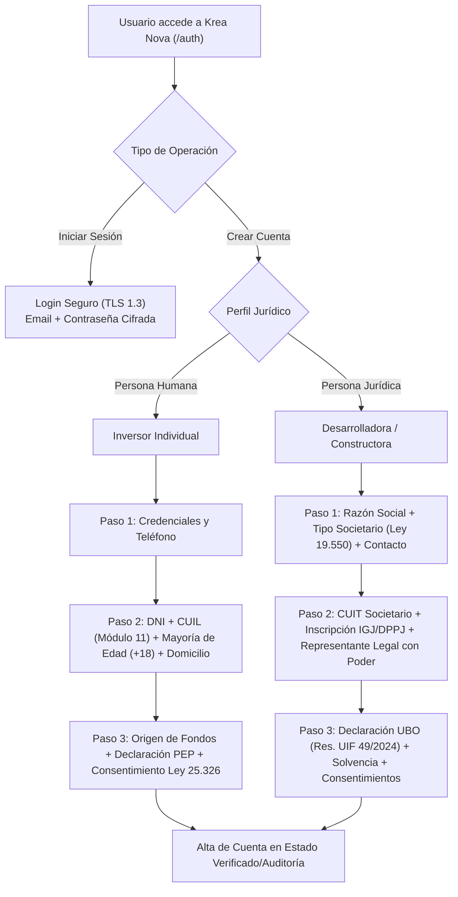

# Arquitectura de Autenticación, Onboarding y Validaciones Legales

**Plataforma:** Krea Nova — Real Estate Investments  
**Jurisdicción:** República Argentina  
**Marco Normativo Base:** [legal.md](../legal.md)  
**Versión:** 1.0  
**Fecha:** 27 de Octubre de 2026  

---

## 1. Resumen Ejecutivo y Enfoque Regulatorio

La plataforma implementa un sistema de autenticación y registro con **debida diligencia diferenciada**, separando estrictamente la incorporación de **Inversores Individuales (Personas Humanas)** frente a **Desarrolladores Inmobiliarios y Constructoras (Personas Jurídicas)**.

Cada perfil está sujeto a regímenes jurídicos distintos en la República Argentina:

---

## 2. Matriz de Diferenciación Legal y Normativa

| Aspecto Regulatorio | Inversor Individual (Persona Humana) | Desarrollador / Constructora (Persona Jurídica) |
|---|---|---|
| **Régimen Principal** | Código Civil y Comercial, Ley 25.326, Ley 27.349, Res. UIF 49/2024 | Ley General de Sociedades 19.550, Ley 17.801, Ley 25.246, RG CNV 1172/2026 |
| **Identificación Tributaria** | DNI (7-8 dígitos) y CUIL (Prefijos 20, 23, 24, 27) | CUIT Corporativo (Prefijos 30, 33, 34) e Inscripción en Registro Público (IGJ/DPPJ) |
| **Capacidad y Edad** | Control estricto de **mayoría de edad (+18 años)** (CCC Art. 24) | Acreditación de personería y facultades del **Representante Legal** (Estatuto / Acta / Poder) |
| **Debida Diligencia AML/KYC** | Declaración de origen lícito de fondos y condición PEP (Persona Expuesta Políticamente) | Declaración de **Beneficiarios Finales (UBO)** con más del 10% de titularidad (Res. UIF 49/2024) |
| **Compromiso Registral** | Aceptación de riesgos de inversión y términos generales | Compromiso de aportar títulos de dominio libres de gravámenes y planos de obra aprobados (Ley 17.801) |

---

## 3. Validaciones Técnicas Implementadas en Frontend

Ubicación del código fuente: [`frontend/src/features/auth/legalValidation.ts`](file:///Users/maurobanegas43/Documents/proyecto_final/frontend/src/features/auth/legalValidation.ts)

### 3.1. Algoritmo Módulo 11 (AFIP / ARCA)
Valida en tiempo real que el CUIT o CUIL ingresado sea matemáticamente válido según la fórmula oficial de la autoridad tributaria argentina:
$$\text{Checksum} = 11 - \left(\sum_{i=0}^{9} d_i \times w_i \pmod{11}\right)$$
donde los ponderadores son $w = [5, 4, 3, 2, 7, 6, 5, 4, 3, 2]$.

### 3.2. Verificación de Mayoría de Edad (+18 Años)
La función `validateAdultAge` calcula de forma exacta la edad del inversor a partir de su fecha de nacimiento y la fecha actual, bloqueando el avance en el formulario si es menor de 18 años, en estricto cumplimiento del Código Civil y Comercial de la Nación y la sección 7.3 de [`legal.md`](file:///Users/maurobanegas43/Documents/proyecto_final/legal.md).

### 3.3. Consentimientos Legales Separados e Independientes
Conforme a la sección 7.6 de [`legal.md`](file:///Users/maurobanegas43/Documents/proyecto_final/legal.md) y las exigencias de la **Ley 25.326** (Protección de Datos Personales), la interfaz prohíbe el agrupamiento de consentimientos. Se exigen casillas independientes para:
1. **Términos y Condiciones Generales (v1.0 - 2026).**
2. **Consentimiento expreso e informado para tratamiento de datos personales (Ley 25.326).**
3. **Declaración jurada de veracidad de datos.**
4. **Comunicaciones comerciales (opcional, desmarcado por defecto).**

---

## 4. Política de Protección de Datos y Separación de Storage

En consonancia con la sección 10 de [`legal.md`](file:///Users/maurobanegas43/Documents/proyecto_final/legal.md), la arquitectura técnica respeta la confidencialidad absoluta:

1. **Datos en Blockchain:**
   - **Regla Estricta:** NUNCA se almacenan en blockchain nombres, DNI, CUIL, domicilios, teléfonos ni correos electrónicos.
   - En la red distribuida únicamente se registran balances de tokens y hashes criptográficos de verificación.
2. **PostgreSQL:**
   - Cuentas de usuario, estados de aprobación KYC (`pending`, `verified`, `requires_documentation`, `rejected`), roles y registro de timestamp de aceptación de términos legales (`termsAcceptedAt`, `privacyAcceptedAt`).
3. **Almacenamiento Cifrado de Documentos (Object Storage):**
   - Fotos de DNI, constancias de CUIT, estatutos societarios y poderes legales se conservan en repositorios cifrados en reposo (AES-256) con acceso restringido.

---

## 5. Advertencia de Prototipo Académico

Conforme a la sección 2 de [`legal.md`](file:///Users/maurobanegas43/Documents/proyecto_final/legal.md), la interfaz de autenticación exhibe de forma prominente la advertencia legal obligatoria:
> **“Entorno Académico Demostrativo:** Plataforma para financiamiento colectivo con derechos tokenizados. Las inversiones y operaciones son simuladas. No se reciben fondos ni se ofrecen inversiones reales.”
